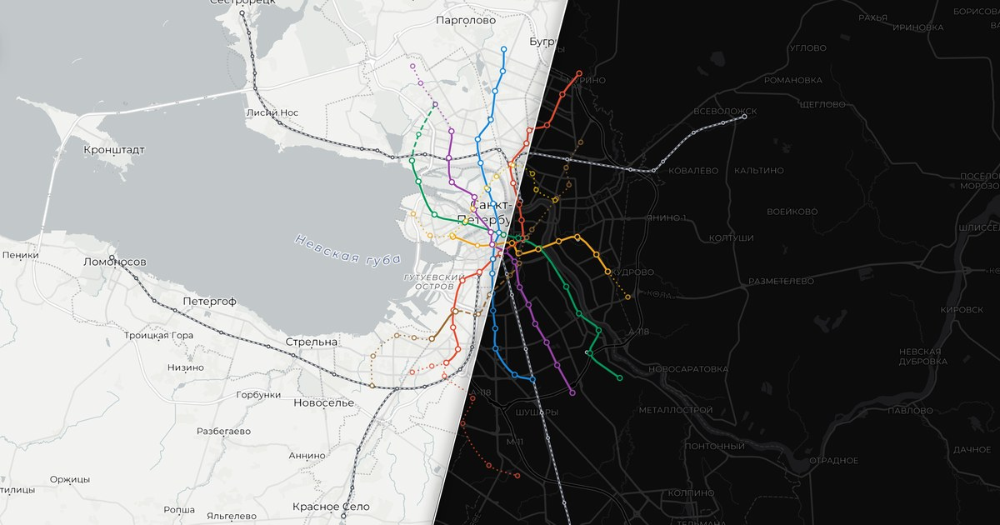
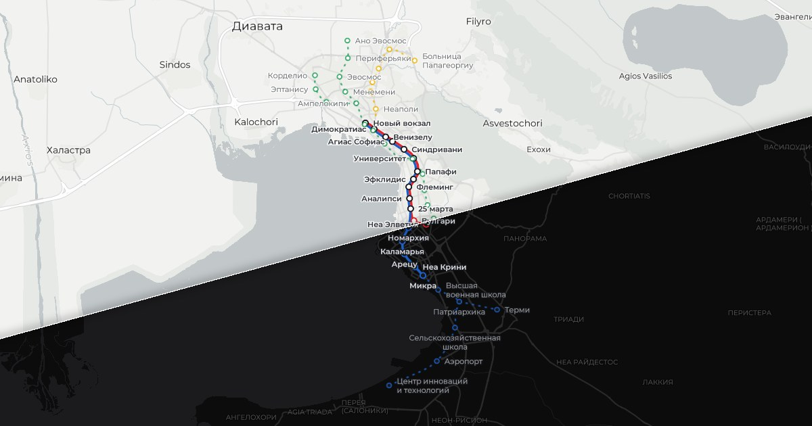

# Метро

**Русский** | [English](README.en.md)

Интерактивные карты метро: Санкт-Петербург и Салоники. Клик по двум станциям — и видно маршрут, время в пути и пересадки. Ползунок «Хронология» показывает, как сеть росла и какой будет по планам развития; маршрут считается по выбранной сети.

[](https://www.typescriptlang.org/) [](https://vite.dev/) [](https://maplibre.org/) [](https://openfreemap.org/)


| [Санкт-Петербург](https://gkalian.github.io/metro/) | [Салоники](https://gkalian.github.io/metro/thessaloniki/) |
| --- | --- |
|  |  |

Города переключаются списком под заголовком панели. Интерфейс на русском и английском, у Салоник ещё и на греческом.

## Санкт-Петербург

Сеть на конец каждого десятилетия с 1950-х, сегодняшняя и будущая по схеме развития до 2040 года. На карте также железнодорожные станции со схемы метрополитена; в маршрут они не входят.

<details>
<summary><b>Станции и линии</b></summary>

- Станции, координаты и статусы (действует / строится / проектируется) — перспективная карта [metrostr.ru](https://www.metrostr.ru/map/).
- Линии между станциями — сглаженная кривая, а не реальная трасса тоннелей.
- «Театральная» отмечена как строящаяся: поезда проходят её без остановки. Год открытия условно 2029-й — срок первого выхода по схеме.
- Пересадки на будущие станции 6-й линии («Каретная», «Заставская», «Лиговский проспект-2», «Знаменская») внесены по проекту линии.

</details>

<details>
<summary><b>Планы до 2040 года</b></summary>

- Годы открытия, ветка красной линии на Пулково, продления до «Коломяжской», «Ручьёв», «Проспекта Маршала Жукова» и северный участок Кольцевой — схема развития из отчёта метрополитена за 2025 год ([Фонтанка, 18.08.2026](https://www.fontanka.ru/2026/08/18/76594703/)). Координаты этих станций сняты со схемы, погрешность — сотни метров.
- Кольцевая линия внесена только северным участком («Большой проспект» — «Полюстровский проспект»): названий остальных станций схема не даёт.
- «Пулковские высоты» и «КВЦ Экспофорум» на схеме без срока — они видны только на шаге «все планы».
- Юго-западный участок 6-й линии (2037) нарисован по схеме, хотя от этой трассировки город, по сообщениям, отказался.

</details>

<details>
<summary><b>Время в пути</b></summary>

- Перегоны между действующими станциями — [spb.metrobook.ru](https://spb.metrobook.ru/), с точностью до минуты.
- Где времени нет (вся 6-я линия и планируемые участки), оно оценено по расстоянию; в данных это `toNextEstimated`, в интерфейсе итог помечен «≈».
- Пересадки — грубая оценка: 3 минуты везде, 1 минута на «Технологическом институте».

</details>

<details>
<summary><b>Электрички</b></summary>

- Станции — те, что на официальной [схеме метрополитена (12.2025)](https://metro.spb.ru/uploads/metromap_12.2025.jpg): пять тактовых направлений (Финляндский вокзал — Сестрорецк и — Мельничный Ручей, Балтийский вокзал — Ораниенбаум-1 и — Красное Село, Витебский вокзал — Павловск), Московский и Ладожский вокзалы и платформы у метро (Удельная, Девяткино, Обухово, Рыбацкое).
- Координаты — [OpenStreetMap](https://www.openstreetmap.org/); Московский вокзал, которого в OSM нет точкой, поставлен вручную у головы платформ.
- Пересадки на метро — по пунктирам схемы. Время в пути для электричек не считается.

</details>

## Салоники

Линия 1 (2024) и линия 2 (2026), а также будущая сеть по плану до 2040 года. Ползунок в прошлом шагает по годам открытий.

<details>
<summary><b>Линии</b></summary>

- Номера и цвета — как на схемах в метро и в брендбуке ([Википедия](https://en.wikipedia.org/wiki/Thessaloniki_Metro)): **1, красная** «Новый вокзал» — «Неа Элветия» (30.11.2024); **2, синяя** «Новый вокзал» — «Микра» (27.08.2026).
- До «25 марта» линии 1 и 2 идут по общим путям: на карте они нарисованы рядом, в маршруте годится поезд любой из них, а при поездке с ветки на ветку показывается смена поезда на «25 марта». Сайт оператора ([thessmetro.gr](https://www.thessmetro.gr/en/metro-stations/)) называет всю сеть линией 1.
- Координаты действующих станций и греческие названия — [OpenStreetMap](https://www.openstreetmap.org/). Русские названия — транскрипция; «Новый вокзал», «Университет» и «25 марта» переведены, как в русской Википедии.

</details>

<details>
<summary><b>Планы до 2040 года</b></summary>

- [Схема развития до 2040 года](https://www.thessmetro.gr/en/plan-for-2040/), порядок станций — [ypodomes.com](https://ypodomes.com/metro-thessalonikis-i-anatomia-tis-neas-grammis-2-amp-oi-nees-epektaseis-tis-grammis-1-poy-tha-ginoyn-oi-26-neoi-stathmoi/): продление линии 2 к аэропорту и ThessINTEC; **3, зелёная** «Ано Эвосмос» — «Агия Кириаки» с веткой на Корделио; **жёлтая** от «Димократиас» к больнице Папагеоргиу.
- Жёлтая линия в плане — продление линии 1; номер 4 условный. Схемы движения нет, поэтому на «Димократиас» маршрут считает пересадку.
- Сроков по участкам нет — всё открывается на шаге «2040». Отросток на Терми обозначен лишь как задел и виден только на шаге «все».
- Координаты будущих станций сняты со схемы (погрешность — сотни метров) и уточнены по ориентирам: площадь Аристотеля, ХАНФ, площадь Харилау, КТЕЛ, больница Папагеоргиу, Высшая военная школа, аэропорт, ThessINTEC.
- [Схема Эллинико Метро 2024 года](https://www.emetro.gr/wp-content/uploads/2024/08/%CE%9C%CE%B5%CF%84%CF%81%CF%8C-18-%CE%A3%CE%91%CE%93%CE%9C%CE%98-A3-Eng-%CE%95%CE%9C-%CE%95%CE%A3%CE%A0%CE%91-2021-2027-1.jpg) рисует северо-запад кольцом через Эвосмос и Ставруполи, но от кольца, [по сообщениям](https://www.typosthes.gr/thessaloniki/438664_metro-thessalonikis-anoigei-o-dromos-gia-epektasi-sta-dytika-poies-einai-oi), отказались.

</details>

<details>
<summary><b>Время в пути</b></summary>

- Время перегонов нигде не опубликовано и оценено по расстоянию: 40 секунд на стоянку и разгон плюс прямая между станциями с запасом 15 %. Скорость подобрана так, чтобы от «Нового вокзала» до «Неа Элветии» выходило 17 минут ([ypodomes.com](https://ypodomes.com/metro-thessalonikis-se-17-lepta-apo-ton-n-s-stathmo-sti-nea-elvetia-ola-osa-thelete-na-mathete-gia-stathmoys-eisitiria-kai-dromologia/)). До «Микры» выходит 22 минуты, пресса пишет о 24–26 ([tanea.gr](https://www.tanea.gr/2026/08/26/greece/metro-thessalonikis-apo-ayrio-stin-kalamaria-o-xristikos-odigos-gia-dromologia-xronous-kai-eisitiria/)). Итог везде помечен «≈».
- Пересадки на линию 3 — 3 минуты на «Новом вокзале» и «Димократиас», 2 минуты на «Университете». Смена поезда на общей станции — без перехода, ожидание не учитывается.

</details>

## Разработка

<details>
<summary><b>Добавление нового города</b></summary>

## Код

```
src/
  main.ts              точка входа: город из data-city страницы → загрузка данных → start
  core/                движок, ничего не знает о конкретном городе
    city.ts            тип City — описание города
    pages.ts           плагин Vite: HTML-страница каждого города из одного шаблона
    start.ts           карта, панель, маршрут в адресе
    domain/            сеть, история, маршруты (без DOM)
    map/  ui/  geo/    карта MapLibre, панель, геометрия
    app/messages/      тексты интерфейса (ru.ts — эталон ключей)
  cities/
    index.ts           список городов
    spb/  thessaloniki/
      city.ts          адрес, заголовки, цвет, языки, границы карты
      data/            lines/*.json, transfers, history, exits, railway
scripts/               глифы шрифтов, генератор данных Салоник
```

HTML-файлов в репозитории нет: страницы генерирует `src/core/pages.ts`. Своя страница у города нужна для превью ссылок — Telegram и VK не выполняют JS. Данные каждого города грузятся отдельно. Линии могут идти по общим путям: в файле линии вместо станции стоит `{"ref": "id"}`, а `since` задаёт год, с которого ходят её поезда. Тесты лежат в `__tests__` рядом с кодом.

### Как добавить город

1. Данные — в `src/cities/<id>/data/`, `data.ts` их собирает, `city.ts` описывает город (образец — `thessaloniki`).
2. Добавить город в `src/cities/index.ts` — страница и ссылка в списке городов появятся сами.
3. Картинка для превью 1200×630 — `public/<path>og.jpg`.
4. Новый язык — тип `Lang`, словарь в `src/core/app/messages`, атрибуты `data-<язык>` в шаблоне; новому алфавиту нужны глифы (см. ниже).

<b>Шрифт</b>

Везде Montserrat: в интерфейсе с Google Fonts, на карте — SDF-глифы в `public/fonts`, собранные `scripts/glyphs.py` (нужны `freetype-py`, `numpy`, `scipy`):

```
python scripts/glyphs.py Montserrat-Regular.ttf "Montserrat Regular" public/fonts
```

Греческих букв в Montserrat нет, их даёт [Manrope](https://github.com/google/fonts/tree/main/ofl/manrope): в интерфейсе он стоит в `font-family` вторым, а на карте греческий диапазон `768-1023.pbf` собран из него поверх Montserrat (`--ranges` переписывает только указанный диапазон, `--wght` задаёт насыщенность). Курсива в Manrope нет, поэтому в наборе Italic греческие буквы прямые.

```
python scripts/glyphs.py "Manrope[wght].ttf" "Montserrat Regular" public/fonts --wght 400 --ranges 768-1023
python scripts/glyphs.py "Manrope[wght].ttf" "Montserrat SemiBold" public/fonts --wght 600 --ranges 768-1023
python scripts/glyphs.py "Manrope[wght].ttf" "Montserrat Italic" public/fonts --wght 400 --ranges 768-1023
```

Оба шрифта под лицензией OFL, тексты лицензий — в `public/fonts`.


Данные Салоник генерирует `scripts/thessaloniki/gen_lines.py` — правки вносить в него, а не в JSON:

```
py -3 scripts/thessaloniki/gen_lines.py src/cities/thessaloniki/data
```

</details>
